# Financial Data Analyzer

A data pipeline and machine learning project for financial markets. It downloads stock and crypto data, cleans it, stores it in layers, and then trains models to predict the next price move.

The project mixes two areas: Data Engineering (moving and shaping the data) and Data Science (making and testing predictions).

## What it does

- Pulls data from three public sources: Yahoo Finance (stocks), Bybit (crypto), and the Fear & Greed Index (crypto sentiment).
- Stores everything in MinIO, which works like Amazon S3.
- Cleans the data and builds a star schema in DuckDB.
- Computes 30+ technical indicators (RSI, MACD, ATR, Bollinger Bands, VWAP, OBV, and more).
- Trains one XGBoost model per asset and time interval.
- Tests the models with walk-forward backtesting against a buy-and-hold benchmark.
- Shows everything in a Plotly Dash dashboard.

## Architecture



The data moves through three layers in MinIO. This pattern is called a Medallion architecture.

### Data layers

1. **Bronze layer** (`s3://raw-data/`) - raw JSON files from the APIs, exactly as received, then converted to Parquet.
2. **Silver layer** (`s3://processed-data/`) - cleaned and validated data. Duplicates removed, schemas enforced, timestamps normalised, and rows kept in chronological order.
3. **Gold layer** (`s3://analytics-data/`) - separate analytics tables for crypto and stocks, with moving averages and technical indicators, plus the feature tables used for ML. Ready for the dashboard and the models.

### Services

| Service | What it does | Port |
|---|---|---|
| MinIO | S3-compatible object storage for the three layers | 9000 (API) / 9001 (console) |
| Prefect | Runs the pipeline with task-level retries and checkpoint/resume | 4200 |
| PostgreSQL | Prefect server backend, replacing the lock-prone SQLite backend | - |
| Python pipeline | The ELT flow itself; runs on startup and then hourly | - |
| Plotly Dash | Dashboard with nine tabs (Overview, Price Dashboard, Predictions, Backtest, Technical Indicators, Data Explorer, Model Health, Model Insights, Pipeline History) | 8050 |
| MLflow | Model experiment tracking | 5000 |
| DuckDB | In-process SQL engine for the transformations | - |

## Pipeline steps

1. **Extract** - Yahoo Finance, Bybit, and Fear & Greed run at the same time, pulling historical OHLCV data plus Open Interest, Funding Rate, and daily crypto sentiment, and saving to MinIO as Parquet.
2. **Load** - DuckDB reads the raw Parquet files from MinIO into staging tables (`yahoo_stocks`, `bybit_crypto`).
3. **Clean** - removes duplicates, filters invalid prices, normalises timestamps, and enforces chronological ordering into the `clean_*` tables.
4. **Dimensions** - builds the star schema (`dim_assets`, `dim_dates`) for analytical querying.
5. **Facts** - loads the cleaned data into `fact_price_history` from the silver layer.
6. **Gold analytics** - aggregates daily volatility and moving averages into `gold_crypto_analytics` and `gold_stock_analytics`.
7. **Technical indicators** - computes 30+ indicators (RSI, MACD, ATR, Bollinger Bands, VWAP, OBV, and more) into `gold_crypto_features` and `gold_stock_features`.
8. **Model training** - `PipelineModelTrainer` finds every asset and interval combo in `settings.yml`, applies the stationarity transforms from `src/models/feature_engineering.py`, and trains one XGBoost model per combo. Models are saved to `src/models/crypto/` and `src/models/stocks/`.

Restarting skips finished steps. Use `--force` to run everything again from scratch, and `--once` for a single run instead of the hourly schedule.

## Models

- **One model per combo** - for example, BTC 1h, BTC 4h, AAPL 1h, and AAPL 1d each get their own XGBoost model.
- **Stationarity transforms** - raw indicators like SMA, EMA, and MACD change with the price level. `make_stationary()` converts them to distance-from-close ratios, so features can be compared across price levels.
- **Walk-forward backtesting** - `backtesting/walk_forward.py` runs a 6-month training window and walks it forward month by month, retraining on each fold to copy real-world periodic retraining. It also supports a pre-trained mode that loads the saved production model per asset, single-asset and multi-asset portfolio modes, and optional short selling and transaction costs. Results are compared with an equal-weight buy-and-hold using the same dates, money, and costs.

## Project structure

- **`backtesting/`** - Walk-forward validation with trade simulation and performance metrics.
- **`configs/`** - Settings for the project, like API keys and database paths.
- **`dashboard/`** - Plotly Dash web app (`app.py`) with the XGBoost predictor (`predictor.py`), model health monitoring (`model_health.py`), and pipeline run history (`pipeline_history.py`).
- **`notebooks/`** - Jupyter notebooks for testing ideas and visualising data before writing the final code.
- **`orchestration/`** - The main Prefect flow and the checkpoint/resume logic that runs the whole pipeline automatically.
- **`scripts/`** - Manual and research scripts, not used by the main pipeline:
  - `investigate_funding.py` - checks and backfills historical funding-rate coverage for all configured Bybit assets.
  - `run_funding_rate_experiment.py` - leakage-safe funding feature experiment with accuracy significance tests and a cost-aware backtest comparison.
  - `run_cross_asset_experiment.py` - leakage-safe cross-asset feature experiment comparing baseline and cross-asset variants.
  - `run_regime_analysis.py` - BTC 1h regime analysis comparing per-regime accuracy against dynamic baselines.
  - `run_feature_ablation.py` - controlled BTC 1h feature-ablation experiment (auto-refreshed after BTC 1h retraining).
  - `compare_model_families.py` - BTC 1h comparison of XGBoost, Logistic Regression, and Random Forest (auto-refreshed after BTC 1h retraining).
  - `compare_multitimeframe_models.py` - BTC 1h/4h multi-timeframe comparison with ensemble metrics (auto-refreshed after BTC 1h/4h retraining).
  - `backfill_pipeline_history.py` - one-time backfill of the pipeline-run audit from existing DuckDB history.
  - `backfill_prefect_history.py` - one-time backfill of run history into the PostgreSQL backend.
  - `build_macro_table.py` - builds the macroeconomic table from FRED data.
  - `data_health_check.py` - checks data quality and coverage per asset and interval.
  - `data_profiler.py` - profiles raw market data for volume and readiness.
  - `ml_profiler.py` - profiles the ML training data and feature distributions.
  - `generate_figures.py` - generates the report figures from the backtest and model results.
  - `inspect_bybit_api.py` - inspects raw Bybit API responses for debugging ingestion.
  - Legacy training scripts, now superseded by `PipelineModelTrainer`: `train_all_models.py`, `train_btc_model.py`, `train_aapl_model.py`, `eda_ml.py`, `top15_feat.py`, `target_analysis.py`.
- **`src/`** - The main source code:
  - `ingestion/` - API clients for Yahoo Finance (`yahoo_finance.py`), Bybit (`bybit_client.py`), and the Fear & Greed Index (`fear_greed.py`).
  - `database/` - DuckDB loading (`loader.py`), dimensional modelling (`dimensions.py`), and fact tables (`facts.py`).
  - `processing/` - scaling, cleaning, and chronological transformation (`transformation.py`).
  - `models/` - gold layer processor, technical indicators processor, feature analyzer, and shared feature engineering (`feature_engineering.py`).
  - `utils/` - console logging (`logger.py`), S3 access setup (`s3.py`), and pipeline run auditing (`pipeline_audit.py`).
- **`tests/`** - Pytest suite covering every module (extraction, database, processing, models, backtesting, dashboard, orchestration) with value-based assertions. It runs with zero infrastructure: no Docker, no S3, and no `.env`.
- **`reports/`** - generated reports: market and ML profiles, funding coverage and experiment results, feature ablation, and model-family and multi-timeframe comparisons.

## How to run

### With Docker (recommended)

```bash
docker-compose up --build -d                                                      # start all services (pipeline runs hourly)
docker exec financial_data_pipeline python -m orchestration.orchestration --once   # single manual run
docker exec financial_data_pipeline python -m orchestration.orchestration --force  # full re-run
```

### Without Docker

1. Install the dependencies:

   ```bash
   pip install -r requirements.txt
   ```

2. Optional but recommended, set up a virtual environment:

   ```bash
   python -m venv venv
   source venv/bin/activate    # On Windows: venv\Scripts\activate
   ```

3. Copy `.env.example` to `.env` and fill in your API keys and the PostgreSQL details (user, password, database).

4. Run the pipeline:

   ```bash
   python -m orchestration.orchestration           # normal run (resumes from checkpoint)
   python -m orchestration.orchestration --once     # single run (no hourly schedule)
   python -m orchestration.orchestration --force    # force full re-run (clears checkpoint)
   ```

## Tests

```bash
pytest
```
